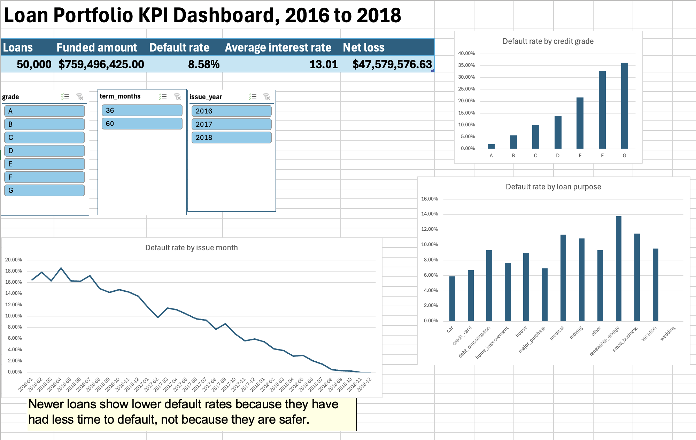

# Loan Portfolio KPI Dashboard

**Excel · PivotTables · XLOOKUP · SUMIFS**

An interactive Excel dashboard that tracks 12 lending KPIs across 50,000 consumer loans
issued from 2016 to 2018, with slicers for credit grade, loan term and issue year.



## Results

| KPI | Value |
|---|---:|
| Total loans | 50,000 |
| Total funded amount | $759,496,425 |
| Average loan size | $15,189.93 |
| Average interest rate | 13.01% |
| Average FICO score | 701.3 |
| Average debt-to-income | 19.30 |
| Default rate, all loans | 8.58% |
| Default rate, closed loans | 22.70% |
| Delinquency rate, active loans | 3.72% |
| Net loss amount | $47,579,576.63 |
| Net loss rate | 6.26% |
| Share of 60-month loans | 28.30% |

## What the numbers say

- **The headline default rate understates risk.** 8.58% of all loans have defaulted, but 60%
  of the loans were still running when the data was captured. Among loans that have ended,
  22.70% ended in default. The dashboard shows both, with definitions.
- **Newer loans look safer only because they are younger.** The default rate falls from
  15.98% for 2016 loans to 1.91% for 2018 loans, and to 0% for loans issued in the last two
  months of 2018. That measures loan age, not loan quality.
- **Credit grade works.** Default rates rise at every step, from 2.06% for grade A to 36.29%
  for grade G.
- **Longer terms default more.** Among 2016 loans, 60-month loans defaulted at 20.75% against
  14.34% for 36-month loans.

### Default rate by credit grade

| Grade | Loans | Default rate, all loans | Default rate, closed loans |
|---|---:|---:|---:|
| A | 10,359 | 2.06% | 6.62% |
| B | 14,895 | 5.69% | 15.52% |
| C | 14,624 | 9.96% | 25.75% |
| D | 6,770 | 13.90% | 33.78% |
| E | 2,455 | 21.59% | 43.27% |
| F | 660 | 32.73% | 52.81% |
| G | 237 | 36.29% | 58.50% |

## How it is built

| Sheet | What it does |
|---|---|
| `dashboard` | Headline KPIs, three charts and three slicers. Everything responds to the slicers. |
| `kpis` | The 12 KPIs for the whole portfolio, each with a plain-English definition and its formula shown as text, so a non-technical reader can see how every number is calculated. |
| `pivots` | PivotTables behind the dashboard: by credit grade, issue year, loan purpose, issue month (with month-over-month change), and portfolio totals. |
| `status_map` | Lookup table that groups the seven raw loan statuses into Performing, Paid off, Delinquent and Defaulted. |
| `loans` | The 50,000 loans plus five helper columns. |

Techniques used:

- **XLOOKUP** maps each loan status to its group through the `status_map` table, so the
  definition of "default" is visible and easy to change.
- **SUMIFS / COUNTIFS / AVERAGE** calculate the 12 KPIs on the `kpis` sheet.
- **PivotTables** group the loans; the average of a 1/0 default flag gives each group's
  default rate. "Show Values As > Difference From" gives the month-over-month change.
- **Slicers** connected to every PivotTable make the dashboard interactive.

## Definitions

- **Defaulted:** loan status is Charged Off or Default.
- **Delinquent:** In Grace Period, Late (16-30 days) or Late (31-120 days).
- **Net loss:** amount funded, minus principal repaid, minus recoveries, for defaulted loans.

## Data

Source: LendingClub accepted loans, 2007 to 2018 Q4 (public dataset, via Kaggle,
"Lending Club Loan Data" by wordsforthewise). The full file has about 2.26 million loans.
`scripts/make_sample.py` keeps the columns needed, keeps loans issued 2016 to 2018
(1,373,228 loans), and draws a reproducible random sample of 50,000. The sample is in
`data/loans_2016_2018_sample.csv`. The full source file is not included in this repo.

## Run it

```bash
pip3 install pandas
python3 scripts/make_sample.py     # needs the full Kaggle file in data/
```

Then open `Loan_Portfolio_Dashboard.xlsx` and go to the `dashboard` sheet.
